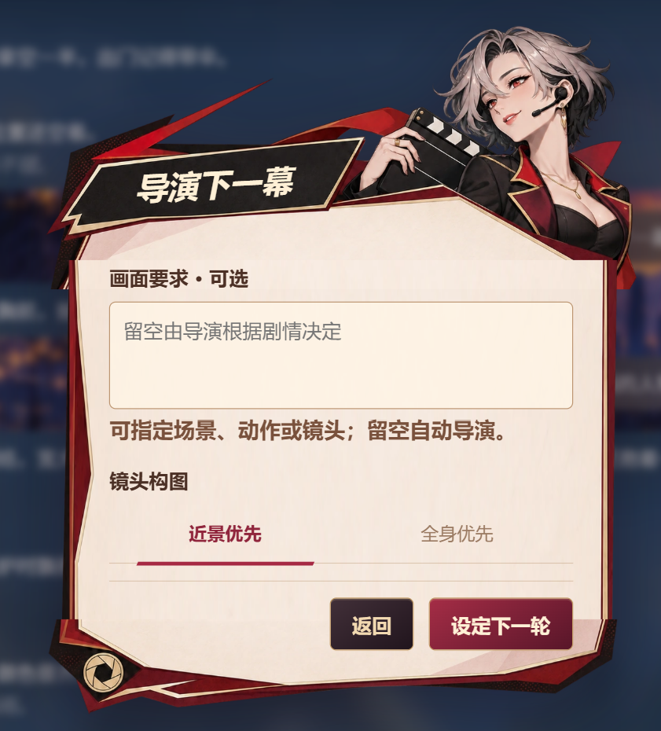
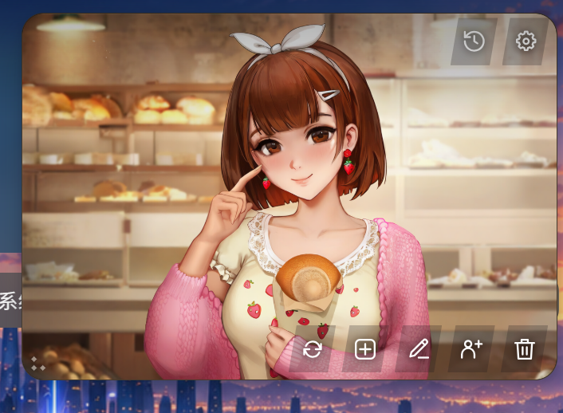

# 青空导演系统 · Aozora Director System

青空导演系统是 Tavo 的生图插件。设定你想看的画面，导演会结合剧情、人物档案和画风安排镜头，生成与故事相连的 CG。

**[直接下载 v1.1.8 安装包](https://github.com/AozoraCynthiAStudio/Tavo-Aozora-Director-System/releases/download/v1.1.8/Aozora_Director_System_V1.1.8.tpg)**


## 功能

- **剧情 CG**：为下一轮剧情选景，也可以从已经保存的回复补图。
- **人物设计与登记**：设计外观并保存人物特征，后续画面可以延续已登记的外貌和穿着。
- **图片调整与动态 CG**：保留原图，新增或重抽候选。NAI 4.5 FULL 支持图生图与动态 CG。
- **画风与历史**：内置四套 NAI 画风，支持自定义画风导入导出。按轮浏览正文和图片，也可查看生成记录。

主力优化面向 NAI 4.5 FULL。其他模型可通过 Tavo 原生生图链路使用通用模式。

## 界面预览

 

[查看动态 CG 示例](src/assets/tutorial/motion-loop.gif)

## 安装

从 [v1.1.8 Release](https://github.com/AozoraCynthiAStudio/Tavo-Aozora-Director-System/releases/tag/v1.1.8) 下载 **Aozora_Director_System_V1.1.8.tpg**，在 Tavo 插件管理中导入。进入聊天后，从输入菜单选择「导演下一幕」或「设计人物外观」。图片服务和教程都在插件界面中。

## 从源码构建

在项目根目录运行以下命令。

```powershell
npm test
npm run build
powershell -NoProfile -ExecutionPolicy Bypass -File scripts/package-local.ps1
```

构建输出在 `dist/`。第三方许可与素材来源分别见 [THIRD_PARTY_NOTICES.txt](THIRD_PARTY_NOTICES.txt) 和 [素材来源](src/assets/provenance.json)。

插件灵感来自「渡鸦生图」，感谢 [渡鸦4455](https://hub.tavoai.dev/webview/creators/H3TAB?scene=plugin)。
